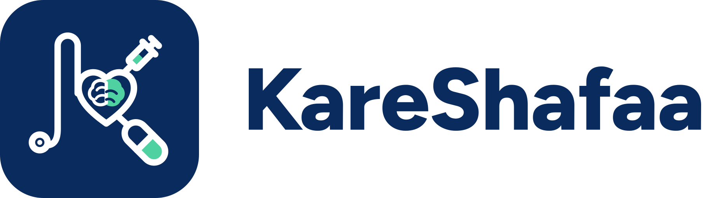

<p></p>

# KareShafaa – Closing the Screening-to-Care Loop

**Live:** https://kareshafaa.onrender.com (Render free plan; the first request after idle can take ~30–60 s while it wakes up)

KareShafaa turns every actionable screening result into a **tracked case** with exactly one accountable owner, an
SLA clock and an escalation path, and keeps it visible until the loop is closed with evidence. Built for the
Hack2skill **Future Health Challenge 05 – Closing the Screening-to-Care Loop**, covering four programmes: bowel (FIT),
cervical (HPV), breast (mammogram, BI-RADS) and diabetes (HbA1c).

**The problem.** Abnormal screening results often never become care: the patient is not told or does not understand,
the referral is rejected or lost, the appointment is missed, and nobody owns the gap. KareShafaa closes that loop:
result in → owned, timed case → patient contacted and understood → referral, booking and attendance → documented
closure.

> Not a certified medical device. Clinical decisions stay with the treating clinician. All records are fictional
> synthetic data, and the messaging gateway is not connected (messages are recorded, not delivered to phones).

## Features

**Focused screens (care, empathy, timely decisions, clarity)**
* Every clinical home starts with **“Needs you now”**: the five most urgent cases in your scope (overdue first, then
  T0→T3), each with the time left in plain words (“Overdue by 3 days”, “5 h left”), the patient's name and preferred
  language, and **one button** for the next step (e.g. “Tell the patient their result”, “Book appointment”). The button
  opens the case; every existing check and confirmation still applies.
* The case screen opens with a **“Now:” bar** — current step, time left, owner and the one next action — above the
  clinical record. Escalations, critical tiers and clinical-review alerts stay visible; nothing safety-relevant is folded away.
* Navigation keeps the 3–4 screens each role uses daily; secondary screens (e.g. audit trail, recall list, “How decisions
  are made”, admin Outcomes/Advanced) sit under **More** (sidebar and phone bottom bar). Long help texts are one tap
  away (“How this page works”, “How requests work”), and empty request panels are hidden.
* Patient app: the **next step comes first** in large type with one clear button, the full step list is one tap away,
  and an always-visible **“Need help?”** row offers “Send a question” and “Change my appointment” (en/ar/hi/ur, RTL).

**Patient summary: contact details and insurance**
* The case screen's **Patient summary** shows phone (tap to call, WhatsApp flag), email, address, preferred language,
  contact preference and **contact consent** (care-coordination consent plus any refused channels) to the roles that
  contact patients (coordinator, GP, specialist, clinical lead). Analysts and admins have no patient views at all.
* **Insurance tile** (FHIR `Coverage`, beneficiary = Patient, payor = payer Organization): insurer, plan, member number,
  valid until, coverage status (active / ends soon / expired / unknown / self-pay) and whether **pre-authorisation** is
  needed; a clean “No insurance on file” state otherwise. The member number is shown in full to coordinators and GPs
  (who book and deal with payers) and the patient; specialists and clinical leads see only the last 4 characters.
  Pre-authorisation is recorded on the patient record (additive column `insurance_preauth_required`).
* Patient app: a read-only **“My insurance”** card next to “My contact details” (en/ar/hi/ur).
* FHIR export per case now includes `Patient.telecom`, the full `Patient.address`, a `Coverage` resource and the payer
  `Organization` (validated against FHIR R4B in the tests).
* Sample data: a one-time data step (`backfill_sample_contact_insurance_v1`) fills **empty** contact and insurance
  fields of `SYN-` synthetic patients only with plausible UAE values (UAE mobiles, `example.com` emails, Abu Dhabi /
  Al Ain / Al Dhafra addresses; Thiqa for Emirati patients, otherwise Daman Enhanced/Basic, ADNIC or GIG/AXA). Plans and
  member numbers are marked synthetic; nothing a person entered is overwritten and non-sample records are never touched.
* **“Has insurance?” Yes / No** (additive nullable column `has_insurance`) on the staff patient form (registration and
  the record's Insurance section). **Yes** shows every policy field (insurer, plan, member number, cover end date,
  pre-authorisation); **No (self-pay)** removes them from the screen, switched instantly without a reload (radio
  buttons in a fieldset, `aria-controls`, the fields use the `hidden` attribute; keyboard and RTL friendly). The server
  applies the same rule whatever is sent: No stores self-pay and **strips** every policy field; Yes **requires** an
  insurer and a member number; not answered clears everything. The summary tile, the record and the patient app's
  “My insurance” card show the full policy for Yes, a compact **“No insurance · Self-pay”** for No and **“Insurance not
  recorded”** when never answered (en/ar/hi/ur). FHIR: Yes → `Coverage` + payer `Organization`; No → a self-pay
  `Coverage` with no policy details; not recorded → no `Coverage`. Older records are read from the insurer
  (insurer → Yes, self-pay → No).
* **Email is editable** by the roles that edit phone and address (coordinator, GP) in the record's Contact details
  (email format checked in the browser and on the server, stored lower-case, change audited as
  `patient.contact_updated` with the field name only), and by patients in “My contact details”. It shows on the case
  summary (with an **Edit** / **Add email** link for those roles) and in FHIR `Patient.telecom`.
* Data step `backfill_sample_email_insurance_answer_v1` (`SYN-` synthetic patients only, empty fields only, audited):
  the first step gave only smartphone users an email, so some sample patients showed “None recorded”; this fills every
  empty sample email with an `example.com` address and records the Yes/No answer (insurer → Yes, self-pay → No).

**Case loop**
* Exactly one accountable owner per open case (enforced in the DB and service layer).
* Deterministic state machine with **SLA tiers T0–T3** (T0 critical, T1 urgent, T2 soon, T3 routine; T0/T1 clocks
  run 24/7, T2/T3 count UAE working days) and an L1–L4 escalation ladder. Handles no-shows, rejected referrals,
  unreachable patients, transfers (two-key), declines and deaths.
* **Closure guard:** a case closes only with evidence (care plan, procedure, negative confirmation) or an authorised
  human decision with a reason.
* Clinical rules engine (`kareshafaa/clinical_rules.py`, sources in `docs/clinical_rules.md`): FIT, HPV/cytology,
  BI-RADS, HbA1c/FPG. Anything unknown, conflicting or out of range goes to a clinical review queue at a safe tier.
* Patient records and registration, recall lists, GP care summaries, specialist e-consults, medications and encounters.

**Patient journey** (`/patient`)
* Step tracker showing where the patient is in the loop.
* Confirm an appointment or ask to change it; messages with replies; teach-back check; contact consent.
* **Appointment requests:** patients can ask for a screening, a follow-up or their next screening from a due recall.
  Nothing is booked automatically — requests land in the **coordinator queue**, where they are confirmed or declined
  with an answer-by deadline.
* Patient messages in English, Arabic, Hindi and Urdu (signed-off wording only; otherwise English plus an
  interpreter-supported call).

**Sign-in and accounts**
* Username + password (argon2id), server-side sessions (HttpOnly, SameSite, Secure on HTTPS), CSRF tokens, idle
  timeout, rate limit and lockout, generic errors.
* **Sign-in help:** `/forgot-username`, `/forgot-password` and `/reset-password`; requests appear in the admin
  **sign-in help panel** on Admin → Users. Admins can set a **temporary password**, which must be changed at the
  next sign-in (`/account/password`).
* Admin user management: create, role, site/team, reset, deactivate/reactivate (never hard-deleted).

**Impact and responsible AI**
* Outcomes dashboard and **loop impact report**, including **“Why loops fail”** (patient-reported vs service-side
  barriers, small cells suppressed, CSV export).
* Governed ML (scikit-learn) used only to order outreach within a tier — never for triage, tier or closure.
  Registry with AUC, calibration and fairness gates; promotion needs clinical-lead approval; drift and rollback.
* Transparency pages: **why this priority** (per case), **rule and model cards**, **override register**,
  **data protection** and **data retention** (Governance).
* Lessons-learned engine proposes rule changes that a human must approve.

**Platform**
* HL7 v2 ORU^R01 and FHIR R4 Bundle ingest (idempotent, ACKs, match review); FHIR R4 export per case;
  capability statement at `/fhir/metadata`.
* `/healthz` (liveness and stats) and `/readyz` (readiness); admin **About** page (`/admin/about`) with system
  details and the API reference.
* UI in **English and Arabic (RTL)**; responsive layout for phone, tablet and desktop; installable PWA.
* Security headers on every response (CSP, HSTS, Permissions-Policy, COOP/CORP), append-only **hash-chained audit
  log** of every read and write (`GET /api/audit/verify`), consent checks, organisation-scoped access.

## Roles

Permissions are defined in `kareshafaa/security.py` (`PERMISSIONS`) and page access in `kareshafaa/ui.py`. Example
usernames come from the staff directory (`kareshafaa/synth/directory.py`, `kareshafaa/seed.py`).

| Role | Example username | What they do |
|---|---|---|
| Admin | `admin` | Menu: Users · System · About; **More:** Outcomes, Advanced. Users and sign-in help, System status, Outcomes (read), Advanced tools (deadline-check runner, model training, proposal engine, simulation, configuration), audit-chain verification, About. **No clinical actions.** |
| Clinical lead | `fatima.al.mansoori`, `layla.al.hashimi` | Menu: Overview (escalations and overdue first) · Work queue · Approvals · Outcomes; **More:** Audit trail, Recall list, How decisions are made. Overview, work queue and every clinical action incl. reopening cases; approvals for models, rules and content; outcomes; audit trail (read). **No admin tools** (users, system, training, configuration). |
| Care coordinator | `aisha.rahman` | Menu: Today's queue · Patients · Due for recall · Results inbox. Today's queue (“Needs you now” first) incl. patient appointment requests, outreach and calls, triage/assign/transfer, referrals, patient registration and invites, recall list, results inbox (HL7/FHIR). |
| GP (family doctor) | `omar.haddad` | Menu: Needs me · Patients · Care summaries · Ask a specialist; **More:** All my cases, Due for recall. Needs-review queue, confirmatory tests, referrals, care plans, authorised closure, care summaries, patients and recalls, ask a specialist. |
| Specialist | `vikram.mehta` | Menu: Needs me · My cases · Patients · Consult requests. Accept or reject referrals with a reason, booking and attendance, care plans, closure, consult replies. |
| Programme analyst | `analyst` | Aggregate outcomes only (small cells suppressed), read-only models and rules. |
| Medical translator | `translator` | Content sign-off: attests that a translation matches the signed-off English. |
| Patient | `patient.en` (also `patient.ar`, `.hi`, `.ur`, `.tl`) | Own results, journey, appointments, requests, messages and consent. |

Coordinators and clinical leads see programme-wide; other clinical roles see cases their organisation is involved in.

## Architecture

* **Backend:** Python 3.11+ (CI on 3.13), FastAPI, SQLAlchemy; SQLite locally, PostgreSQL (Neon) in production via
  psycopg 3. Server: `python -m kareshafaa.serve` (multi-process, watchdog, per-request time budget).
* **Frontend:** server-rendered Jinja templates + vanilla JS, service worker, no build step.
* **Interop:** HL7 v2, FHIR R4 (R4B model validation in tests).
* **ML:** scikit-learn, lazy-loaded; model files also stored in the DB (`model_artifacts`).
* Details: `docs/architecture.md`, `docs/background_jobs.md`, `docs/performance.md`.

```
kareshafaa/            app: main.py, ui.py, security.py (RBAC), accounts.py, sla.py, statemachine.py,
                       clinical_rules.py, fhir.py, api/ (routes), services/, ml/, comms/, synth/ (synthetic data),
                       templates/, static/
kareshafaa_reference/  independent reference rules engine (differential testing)
tests/                 pytest suite
scripts/               handover example, load tests, Locust, UI/a11y/perf checks, validators, fault injection
samples/               HL7 and FHIR example messages
docs/                  clinical rules, safety case, security, performance, pilot plan, business model, handover/
ci/                    github-actions-ci.yml
deploy/, Dockerfile, docker-compose.yml, render.yaml, DEPLOY.md, Makefile
```

## Run locally

```bash
make setup     # .venv + dependencies
make seed      # synthetic patients, history, trained models (SQLite in data/)
make run       # http://localhost:8000
make test      # pytest
```

Locally (standard mode, no password env var set) random first passwords for staff accounts are written to a
gitignored file outside the repo; set `KARESHAFAA_DEMO_PASSWORD` to choose one instead. Other targets: `make help`
(`seed-large`, `validate`, `test-clinical`, `differential`, `fault-injection`, `ui-smoke`, …).

**Handover example** (fresh synthetic DB, HL7 + FHIR inputs, alerts/SLA/FHIR/audit, fixed-seed evaluation; never
touches `data/kareshafaa.db`):

```bash
bash scripts/handover_example.sh [OUT_DIR]    # default ./handover_run
```

**Docker + PostgreSQL:** put `KARESHAFAA_SECRET_KEY`, `KARESHAFAA_DEMO_PASSWORD` and `POSTGRES_PASSWORD` in a `.env`
file (never committed), then `docker compose up --build` → http://localhost:8000.

**Load test (Locust):** `locust -f scripts/locustfile.py --host http://127.0.0.1:8000 --headless -u 20 -r 5 -t 60s`
(see `docs/loadtest_locust.md`).

**Scale load test (baseline / after):** `bash scripts/loadtest/run.sh` seeds throw-away SQLite databases with
500, 5,000 and 20,000 open synthetic cases in `/tmp/lt` and measures the work queue (1, 10 and 25 users), case page,
dashboard, patient search, recalls and proposal generation (latency, SQL statements, memory); see
[`scripts/loadtest/README.md`](scripts/loadtest/README.md) and results in [`docs/loadtest_scale.md`](docs/loadtest_scale.md).

**Work-queue performance (stored SLA thresholds):** each open case stores the absolute times its current step turns
amber (`sla_amber_at`) and red (`sla_red_at`); the work queue compares them with the current time and filters, counts,
orders and pages in SQL (SQLite and PostgreSQL), so only the requested page is read. The columns are derived data: a
database flush hook keeps them current on every case, step and SLA-rule change, and start-up recomputes them
idempotently (additive migration). Proposal generation reads pending proposals and configuration once per run.
`scripts/loadtest/queue_equivalence.py` checks the SQL queue against the former Python ordering on any database.

**CI:** the workflow (tests + coverage, pip-audit, bandit, axe accessibility) is kept at `ci/github-actions-ci.yml`;
copy it to `.github/workflows/` to enable it on GitHub.

## Deployment

Render web service (`render.yaml`, Docker) auto-deploys from `master`; data lives in Neon Postgres. Step-by-step
guide: [`DEPLOY.md`](DEPLOY.md). Environment variables (set in the Render dashboard; values are never committed):

| Variable | Purpose |
|---|---|
| `DATABASE_URL` | Neon PostgreSQL connection string (secret). Without it the app falls back to SQLite on a temporary disk and warns in Admin → System. |
| `KARESHAFAA_SECRET_KEY` | Session/token signing key (secret, required in production). |
| `KARESHAFAA_DEMO_PASSWORD` | First password for staff accounts that have none yet (secret; never overwrites a changed password). |
| `KARESHAFAA_MODE` | `production` on Render. |
| `WEB_WORKERS`, `KARESHAFAA_SWEEP_INTERVAL_SECONDS` | Worker count and SLA-sweep interval. |

Neon note: prefer the **unpooled (direct) connection string** from Neon's *Connect* dialog for the app's long-lived
connections and transaction-scoped advisory locks. On first start against an empty database, `python -m
kareshafaa.bootstrap` creates the schema and copies in the initial records once; existing data is never reset.

## Documentation

* Handover package: [`docs/handover/`](docs/handover/README.md) — problem brief, runnable project, task I/O
  agreement, test results, pilot plan, handover session (PDF/DOCX included)
* [`docs/security.md`](docs/security.md) · [`docs/performance.md`](docs/performance.md) ·
  [`docs/loadtest_scale.md`](docs/loadtest_scale.md) ·
  [`docs/pilot_plan.md`](docs/pilot_plan.md) · [`docs/business_model.md`](docs/business_model.md)
* [`docs/clinical_rules.md`](docs/clinical_rules.md) · [`docs/clinical_safety_case.md`](docs/clinical_safety_case.md) ·
  [`docs/human_signoff.md`](docs/human_signoff.md) · [`docs/patient_messages.md`](docs/patient_messages.md)
* [`docs/architecture.md`](docs/architecture.md) · [`docs/synthetic_data.md`](docs/synthetic_data.md) ·
  [`docs/alert_precision.md`](docs/alert_precision.md) · [`docs/ml_calibration.md`](docs/ml_calibration.md)
* [`docs/deployment_uae.md`](docs/deployment_uae.md) · [`docs/BRAND.md`](docs/BRAND.md) · [`ITERATIONS.md`](ITERATIONS.md) (build log)

## Keeping this README current

**Update this README in the same commit as any change to features, roles/permissions, routes or setup.**
