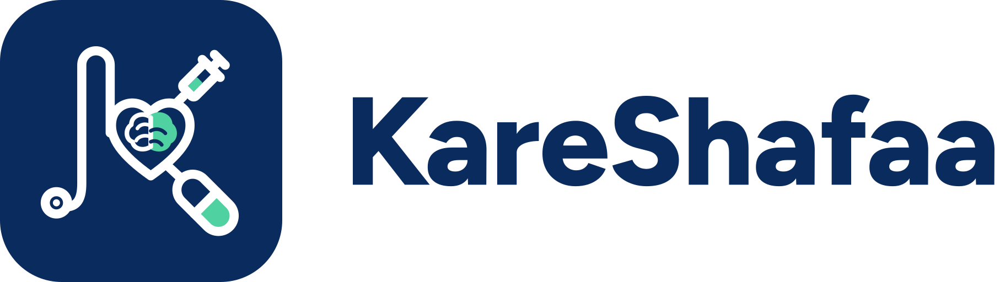

# KareShafaa logo and brand guide

The mark is a rounded navy badge. Inside it, a stethoscope forms the letter **K**, with a heart holding a brain at its
centre, a syringe and a capsule. Next to it is the **KareShafaa** wordmark. The wordmark uses **Latin script only**:
there is no Arabic lettering in the mark or the wordmark, and the brand name is never translated.

## Colours

| Name | Hex | RGB | Use |
|---|---|---|---|
| KareShafaa Navy | `#0A2B5E` | 10, 43, 94 | badge, wordmark, browser/app theme colour (`theme_color`, `<meta name="theme-color">`) |
| KareShafaa Mint | `#4FD1A1` | 79, 209, 161 | accent inside the mark (brain half, syringe, capsule); OG image rule |
| White | `#FFFFFF` | 255, 255, 255 | line work inside the badge; background |
| App UI teal (interface only, not part of the logo) | `#0A6B66` | 10, 107, 102 | buttons and links in the app (`--c-primary`) |

On dark backgrounds use the `*-on-dark` files. They have a white wordmark and a faint white keyline, so the navy
badge edge stays visible. For one-colour printing, embroidery or fax, use `*-mono-navy` or `*-mono-white`.

## Files

| File | What it is |
|---|---|
| `icon.svg` | badge, full detail (48 px and up) |
| `icon-small.svg` | badge simplified for 16-48 px (favicon, app header) |
| `icon-on-dark.svg`, `icon-mono-navy.svg`, `icon-mono-white.svg` | badge variants |
| `logo-horizontal*.svg` | badge + wordmark side by side (default logo) |
| `logo-stacked*.svg` | badge above wordmark (square spaces, splash, posters) |
| `favicon.ico` | 16, 32 and 48 px favicon |
| `png/icon-16/32/48/192/512/1024.png` | app and favicon PNGs (transparent) |
| `png/apple-touch-icon-180.png` | iOS home-screen icon (opaque, full bleed) |
| `png/icon-maskable-512.png` | Android maskable icon (mark inside the 80 % safe zone) |
| `png/og-1200x630.png` | social / link-preview image (Open Graph, Twitter card) |
| `png/logo-*-1200w.png`, `png/logo-stacked-*-800w.png` | raster logos for documents and slides |
| `source/*.svg` | intermediate SVGs for the app icon, maskable icon and OG image |
| `Figtree-OFL.txt` | font licence |

These are the same files the app serves, from `kareshafaa/static/brand/`, `static/icons/` and `static/favicon.*`.
Rebuild everything with `LOGO_OUT=<dir> python scripts/make_pwa_icons.py`. The source geometry is in `scripts/brand/`.

## Clear space

Keep empty space on every side of the logo equal to **one quarter of the badge height** (128 units on the 512-unit
badge). Nothing else may enter that space: no text, no edge of the page, no other logo. In the app header, the 32 px
badge has at least 8 px of space around it.

## Minimum size

* Badge: 16 px on screen. Below 48 px always use `icon-small.svg`, which has thicker lines and fewer details.
* Horizontal logo: 120 px wide on screen (badge about 30 px), or 30 mm wide in print.
* Stacked logo: 80 px wide on screen, or 20 mm in print.
* Below these sizes, use the badge alone.

## Typeface

The wordmark is **Figtree ExtraBold (weight 800)** with -10 unit tracking, converted to outlines, so no font file is
needed to display the logo. Figtree is © 2022 The Figtree Project Authors and is licensed under the **SIL Open Font
License 1.1** (see https://openfontlicense.org). The OFL lets the font be used, embedded and
bundled freely, including commercially. The font itself may not be sold on its own, and modified versions may not use
the reserved font name. The logo artwork is not a modified font, so it is not restricted by this.

## Do

* Use the supplied files exactly as they are. Scale them proportionally.
* Use the navy logo on white or light backgrounds, the on-dark logo on navy or photos, and mono where only one colour is possible.
* Keep the clear space and the minimum sizes.
* Write the name as one word with two capitals: **KareShafaa**.

## Don't

* Don't stretch, rotate, skew, outline or add shadows or gradients.
* Don't recolour the mark (for example teal, red or a gradient). Don't swap the navy and the mint.
* Don't add Arabic or any other script to the logo, and don't translate the name. In the UAE, Arabic "شفاء" marks are owned by others.
* Don't rebuild the wordmark in another font or retype it in live text.
* Don't put the full-colour logo on busy or mid-tone backgrounds where the badge edge disappears. Use the on-dark or mono version.
* Don't use the badge as a clinical symbol (for example to mark results or alerts) inside the app.
