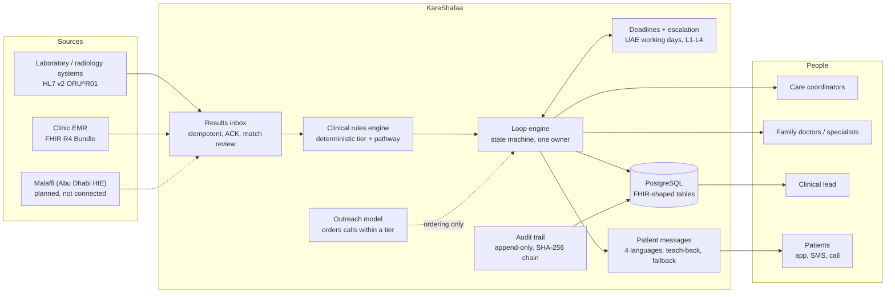
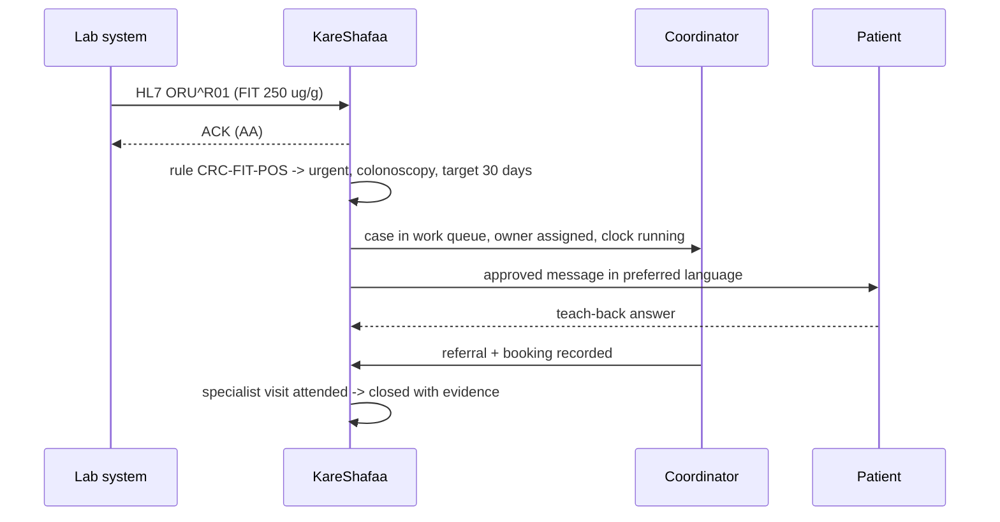

# KareShafaa architecture

KareShafaa closes the loop between an abnormal screening result and the first specialist visit. It is a single
Python service (FastAPI + SQLAlchemy) with a PostgreSQL database, server-rendered pages and an installable patient
app. Administrators see the same overview in the product under **About** (`/admin/about`).

## Components and data flow

| Part | Code | Notes |
|---|---|---|
| Results inbox | `kareshafaa/services/ingest.py`, `api/ingest.py` | HL7 v2 (MLLP-framed or plain) and FHIR R4 Bundles; duplicate messages are recognised; uncertain patient matches wait for a person |
| Clinical rules engine | `kareshafaa/clinical_rules.py`, `docs/clinical_rules.md` | Each rule has an ID; the case screen shows the rule, its source and the clinician changes ("Why this priority") |
| Loop engine | `kareshafaa/statemachine.py`, `services/workflow.py` | Closure only with evidence (attended specialist visit) or a signed clinical decision |
| Deadlines and escalation | `kareshafaa/sla.py`, `services/escalation.py` | Step clocks per state and tier; UAE working-day calendar |
| Patient messages | `kareshafaa/comms/` | Approved templates in English, Arabic, Hindi and Urdu; delivery is simulated in this prototype |
| Outreach model | `kareshafaa/ml/` | Model registry, fairness gates, approval by the clinical lead, rollback. Never sets a tier or closes a case |
| Audit trail | `kareshafaa/audit.py` | Every read and write; chain check at `/api/audit/verify` |
| Impact report | `kareshafaa/services/impact.py` | Loop closure, time to specialist against target, lost to follow-up, recall uptake, equity |
| Interoperability | `kareshafaa/integration.py`, `/fhir/metadata` | FHIR R4 CapabilityStatement; per-case FHIR export |

## Case lifecycle

The state machine is in `kareshafaa/statemachine.py` (and in Figure 1 of the solution design). In short:
result issued → triaged → patient told → understood → confirmation test or consultation → referral → appointment →
attended → care started → closed with evidence. Unreachable patients, declines, no-shows and transfers have
their own states, and closing without evidence always needs a clinician's signed decision.

## Request path

## Security and roles

* Roles: coordinator, family doctor, specialist, clinical lead, analyst, administrator, translator, patient.
  Each page and API call checks a named permission (`kareshafaa/security.py`); administrators cannot read
  clinical records, clinical staff cannot manage accounts.
* Sessions are server-side, cookies are `HttpOnly`/`SameSite`, writes need a CSRF token or a bearer token.
* The public API description (`/docs`, `/openapi.json`) is switched off; administrators can download it from **About**.
* Health checks: `/healthz` (process alive) and `/readyz` (database reachable and initial records present).

## Related documents

* `docs/background_jobs.md`: background work and how it scales
* `docs/deployment_uae.md`: cloud, on-premises and UAE data residency
* `docs/clinical_rules.md`: signed-off rule tables
* `docs/loadtest_locust.md`, `docs/loadtest_ramp.md`: load results
